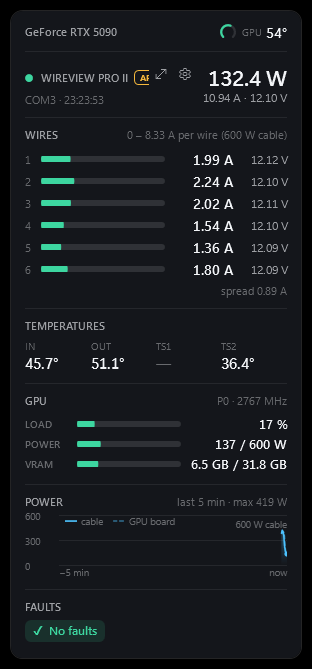
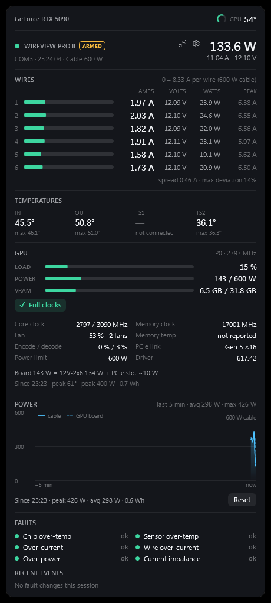
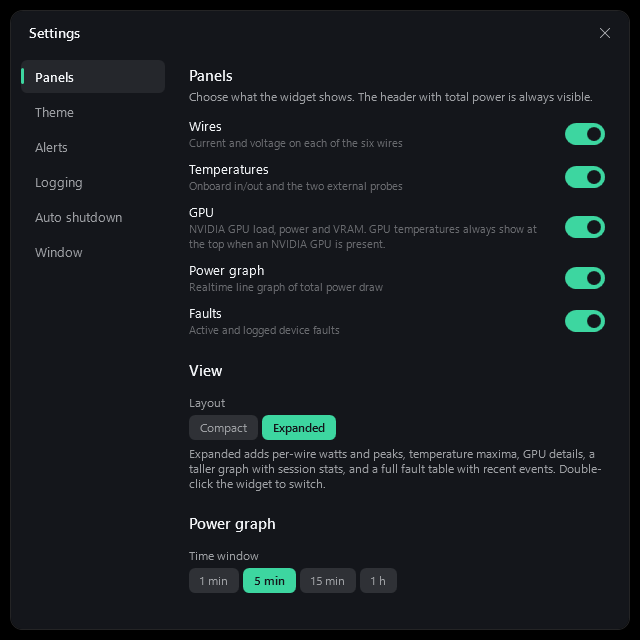
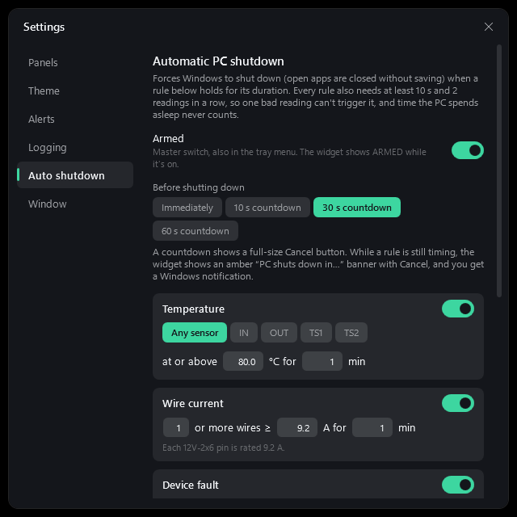
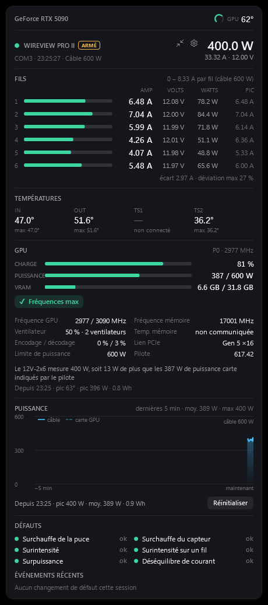
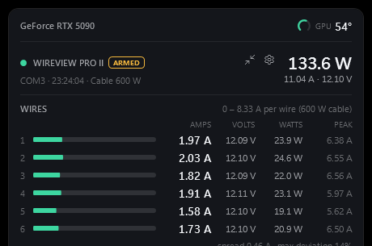

# AmpTray for WireView Pro II

An **unofficial**, read-only desktop widget and tray icon for the Thermal Grizzly WireView Pro II 12V-2x6 power meter, with NVIDIA GPU stats alongside. This project is an independent community tool: it is not affiliated with, endorsed by or supported by Thermal Grizzly or NVIDIA. For firmware updates, device configuration and warranty matters use the official WireView software.

<p align="center">
  &nbsp;&nbsp;
  
</p>

It shows, live:

- GPU temperature right at the top (NVIDIA only), with the driver's throttle point as the gauge's full scale
- current and voltage on each of the six wires, scaled to what one wire may carry under the cable rating
- the four WireView temperatures
- GPU load, power and VRAM, plus clocks, fan, throttle reasons and more in the expanded view
- a realtime power graph with the measured cable power and the driver-reported GPU board power on one chart
- active and logged device faults

It can also log everything to CSV, raise a full-screen alarm on a fault, and (if you arm it) shut the PC down on user-defined thresholds. The interface is available in English, French, Danish and Polish.

## The device is never written to

The widget only ever does two things on the serial port:

- **Identify the device:** it raises RTS and the device replies with its welcome string.
- **Read the sensors:** it sends `0x04` (`CMD_READ_SENSOR_VALUES`) and reads back the 100-byte sensor struct.

There is no code path for config, calibration, flash, screen, clear-fault or bootloader commands (see `Device/WireViewReader.cs`). The port is opened only for each read, under the shared `Global\Access_USB_Sensors` mutex, so the official WireView app and the widget can run side by side. GPU data comes from NVIDIA's NVML; only its read calls are declared.

## Install

Grab the latest release from the **Releases** page:

- `AmpTray-<version>-x64.msi` — installer (Program Files, Start Menu entry, clean upgrades and uninstall)
- `AmpTray-<version>-win-x64-portable.zip` — unzip anywhere and run `AmpTray.exe`

Both are self-contained; no .NET install is needed. Windows 10/11 x64. GPU stats need an NVIDIA driver; everything else works without one.

The installer's first page asks which language the widget should use (follow Windows, English, Français, Dansk or Polski); it can be changed later in Settings → Window. For unattended installs pass it on the command line:

```
msiexec /i AmpTray-<version>-x64.msi /qn APPLANGUAGE=fr
```

## Use

- Drag the widget to move it. Double-click to switch between compact and expanded.
- Hover for the expand and settings buttons. Right-click the widget or tray icon for the menu.
- Left-click the tray icon to show or hide the widget. Launching the app a second time just shows the widget.
- Settings are in `%APPDATA%\AmpTray\settings.json`.

### Settings

<p align="center">
  &nbsp;&nbsp;
  
</p>

| Page | What it controls |
|------|------------------|
| Panels | Wires, Temperatures, GPU, Power graph and Faults on/off; compact or expanded layout; graph time window. |
| Theme | Six presets or a Custom theme with your own background, text, accent, warning, critical and graph colours. |
| Alerts | Screen flash, widget flash, alarm sound and volume, Windows notification, bring to front; 5-second test. |
| Logging | CSV on/off, interval (every sample, 5 s, 10 s, 1 min), folder. |
| Auto shutdown | Arm/disarm, countdown, and the rules below. |
| Window | Always on top, click-through lock, opacity, refresh rate, start with Windows, language. |

### Languages

English, Français, Dansk and Polski. The widget follows the Windows display language by default; pick one explicitly on Settings → Window. Translations live in `Resources/Strings/<code>.json` (English text → translation); a missing entry falls back to English, so adding a language is a matter of adding one file and its code to `Loc.Languages`.

<p align="center">
  
</p>

## GPU panel

Compact: load, power against the enforced power limit, and VRAM, with P-state and core clock in the header. Throttle chips (Power cap, Thermal, …) appear whenever the driver is holding clocks back.

Expanded adds core/memory clocks against their maximums, fan speed, memory temperature (when the GPU reports it), encoder/decoder load, PCIe link, power limit and driver version, plus:

- **Power path** — the driver's board power next to what the WireView measures on the 12V-2x6 cable, so you can see how much is coming through the PCIe slot: `Board 212 W = 12V-2x6 196 W + PCIe slot ~16 W`.
- **Session** — peak temperature, peak power and energy used (from the driver's energy counter where available).

The power graph overlays GPU board power (dashed) on the measured cable power (solid).

Only the first NVIDIA GPU is shown; set `GpuIndex` in `settings.json` to pick another.

## Updates

At every launch the widget asks GitHub once for the latest release (`api.github.com/repos/borexola/AmpTray/releases/latest`, anonymous, nothing about the PC is sent). If it is newer than the running version, a blue banner appears at the top of the widget with a **Download** button that opens the release page, plus an entry in the tray menu; dismissing the banner hides it until the next launch. Turn the check off on Settings → Window.

## Fault alerts

When the device reports an active fault: every monitor gets a pulsing red frame and banner (click-through, never steals focus), the widget flashes red, a two-tone alarm loops, and Windows shows a notification. This works with the widget hidden in the tray. Press **Acknowledge** on the widget or in the tray menu to stop it; a different new fault alerts again.

A fault marked **logged** happened earlier and is latched on the device. Clear it in the official app; the widget is read-only.

## Auto shutdown (off by default)

Arm it on Settings → Auto shutdown or in the tray menu; the widget shows **ARMED**. It runs `shutdown /s /f /t 0` (force-closes apps) when any enabled rule holds for its duration:

| Rule | Condition |
|------|-----------|
| Temperature | Any WireView sensor (or IN, OUT, TS1, TS2) ≥ X °C for Y min |
| Wire current | N or more wires ≥ X A for Y min |
| Device fault | Any selected fault type active for Y min |
| Total power | ≥ X W for Y min |
| GPU temperature | NVIDIA GPU ≥ X °C for Y min |

Safeguards:

- a rule needs its condition to hold for its duration **and** at least 10 s, confirmed by at least 2 readings in a row from its own source, and the latest reading must still satisfy it;
- while a rule is timing the widget shows an amber countdown banner with **Cancel**, and Windows shows a notification; cancelling pauses that rule until its condition clears;
- a dip below the threshold shorter than 10 s does not reset the timer, so a sensor hovering at the threshold cannot defeat a rule;
- timers reset when the device stops reporting, when the PC resumes from sleep, or when the system clock changes — time spent asleep never counts;
- a stale GPU reading is ignored; a refused shutdown (e.g. Windows already has a restart scheduled) is reported and retried after a minute;
- every sensor frame is sanity-checked (ranges and the device's own totals) before it can feed a rule.

Optionally a 10/30/60 s on-screen countdown with a big Cancel button runs first; it counts real elapsed time, capped per tick, so it cannot expire while the PC is asleep. Every countdown, cancel and shutdown is logged to `shutdown_events.log` in the log folder. **Dry run test** shows what would happen without shutting down; setting `WIREVIEW_SHUTDOWN_DRYRUN=1` in the environment turns the real trigger into a log line for testing.

## Wire bars

<p align="center">
  
</p>

A full bar is one wire's share of the cable rating the device reports (600 W → 8.33 A, 450 W → 6.25 A, 300 W → 4.17 A, 150 W → 2.08 A; 9.2 A pin rating if unknown). Amber at that share (or 8 A, whichever is lower), red at 9.2 A. The tray icon's six bars use the same scale.

## CSV columns

`timestamp, total_w, total_a, wire1-6_v, wire1-6_a, wire1-6_w, temp_in/out/ts1/ts2_c, fault_status, fault_log, active_faults, gpu_temp_c, gpu_mem_temp_c, gpu_load_pct, gpu_power_w, gpu_power_limit_w, gpu_mem_used_mb, gpu_core_mhz, gpu_fan_pct`

One file per day (`wireview_yyyy-MM-dd.csv`). Other programs can read a file while it is being written.

## Command line

| Switch | Effect |
|--------|--------|
| `--settings` / `--settings:Theme` | Open Settings (optionally on `Panels`, `Theme`, `Alerts`, `Logging`, `AutoShutdown` or `Window`). |
| `--test-alert` | Fire the 5-second test alert. |

## Trademarks and third-party components

- *WireView* and *Thermal Grizzly* are trademarks of Thermal Grizzly Holding GmbH; *NVIDIA* and *GeForce* are trademarks of NVIDIA Corporation. They are used here only to identify the hardware this tool works with.
- Nothing from the official WireView software or firmware is included. The widget talks to the device with two read-only requests whose formats were determined for interoperability; the code is original.
- GPU data is read through NVML (`nvml.dll`), which is part of the NVIDIA display driver already installed on the PC; it is not redistributed.
- Built with .NET (MIT), `System.IO.Ports` (MIT), the WiX Toolset (MS-RL, build-time only) and GitHub Actions. Icons use the Segoe Fluent Icons font shipped with Windows.

## Building

Requires the .NET 10 SDK.

```
dotnet build                 # debug build
.\build.ps1                  # self-contained publish + portable zip + MSI into artifacts\out
.\build.ps1 -SkipInstaller   # without the MSI
```

`build.ps1` installs WiX 5 locally (into `artifacts\tools`) if it is not on the PATH. The MSI is defined in `installer/Product.wxs`; the icon is generated by `build/make-icon.ps1`.

### Releases

Pushing a tag `vX.Y.Z` runs the **Build** workflow, which builds the zip and MSI and publishes them as a GitHub release with generated notes. Every push and pull request also builds and uploads the artifacts. The first release is `v0.0.1`.
