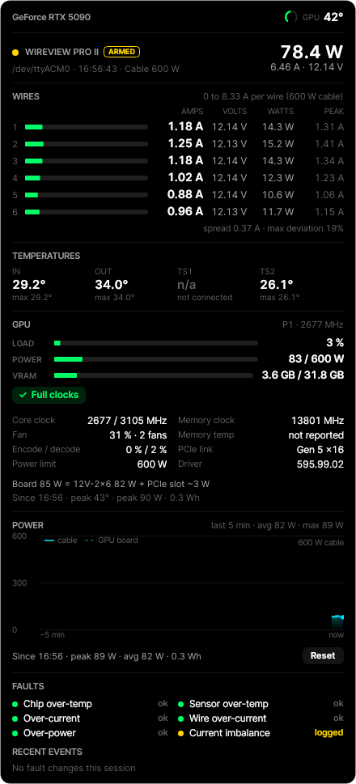

# AmpTray for WireView Pro II

An unofficial, read-only desktop widget and tray icon for the Thermal Grizzly WireView Pro II 12V-2x6 power meter, with NVIDIA GPU stats alongside. For Windows and Linux. Not affiliated with Thermal Grizzly or NVIDIA.

<p align="center">  
  &nbsp;&nbsp;&nbsp;
  
</p>

## What it shows

- Current and voltage on each of the six wires, scaled to what one wire may carry under the cable rating
- GPU temperature at the top, plus load, power and VRAM; clocks, fan, throttle reasons and more when expanded
- The four WireView temperatures and the device's active and logged faults
- A live power graph with the cable reading and the driver's GPU board power on one chart
- Board power split between the 12V-2x6 cable and the PCIe slot, and session peaks and energy

Also: CSV logging, a full-screen alarm on faults, auto-shutdown on your own thresholds, six themes, English, French, Danish and Polish, and an update banner when a new release is out.

## The device is never written to

The widget only identifies the device (raise RTS, read its welcome string) and reads the sensor block (`0x04`). There is no code path for config, calibration, flash, screen, clear-fault or bootloader commands. The port is opened per read under a shared lock (the `Global\Access_USB_Sensors` mutex on Windows, so the official app and the widget can run together; `/run/amptray/device.lock` on Linux, shared by the widget and the service). GPU data comes from the driver's own NVML; only read calls are declared.

## Install

Download from [Releases](https://github.com/borexola/AmpTray/releases):

- `AmpTray-<version>-x64.msi`: installer with Start Menu entry, clean upgrades and uninstall
- `AmpTray-<version>-win-x64-portable.zip`: unzip anywhere and run `AmpTray.exe`
- `AmpTray-<version>-linux-x64.tar.gz` / `-linux-arm64.tar.gz`: the widget and the background service for Linux, see [Linux](#linux)

All are self-contained (no .NET install needed); the Windows builds need Windows 10/11 x64. The installer's first page picks the widget language; unattended: `msiexec /i AmpTray-<version>-x64.msi /qn APPLANGUAGE=fr`.

## Use

- Drag to move. Double-click to switch between compact and expanded; the widget always starts compact. Compact shows only the panels you pick in Settings, expanded shows everything. Hover for the expand and settings buttons.
- Opacity goes down to 5 %. Only the panel background fades: text, bars and gauges stay solid and get an outline once the background is thin, so the readings stay legible over anything behind the widget. By default the widget turns solid while the mouse is over it.
- The GPU temperature and the FPS counter in the top bar can each be turned off (Settings → Panels → Top bar). With several monitors you can pick which screen's game the FPS counter follows; by default it follows the app in the foreground.
- Right-click the widget or tray icon for the menu. Left-click the tray icon to show or hide the widget.
- Settings pages: Panels, Theme, Alerts, Logging, Auto shutdown, Window (always on top, click-through, opacity, refresh rate, start with Windows, language, update check) and About (version you are running, manual update check, links).
- Switches: `/settings`, `/settings:Theme`, `/test-alert` (on Linux `--settings`, `--settings:Theme`, `--test-alert`).

## Starting with Windows and running before sign-in

- The widget registers itself to start when you sign in (Settings → Window → Start with Windows turns it off).
- A Windows window cannot exist before someone signs in, so protection from boot is handled by a **background service**: the same exe started as `AmpTray.exe /service` under LocalSystem. It polls the device and GPU, writes the CSV log and applies the auto-shutdown rules exactly like the widget, using the same read-only requests. While it runs, it is the one that issues the shutdown (with Windows' own countdown when a countdown is configured) and the widget shows the banner and can still cancel.
- The installer offers the service as a checkbox (on by default; `INSTALLSERVICE=0` for unattended installs). Settings → Window → Background monitoring turns it on or off later, which asks for administrator approval.
- The service reads `C:\ProgramData\AmpTray\service.json`, which the widget keeps in sync with your settings, and logs to `service.log` next to it.
- The service also provides the **FPS counter** shown at the top of the widget. It runs Intel's PresentMon (shipped as `PresentMon.exe`, MIT licence), the reference tool that counts presented frames from the Windows graphics trace, and reports frames per second for the game in the foreground (or on the chosen monitor). Without the service the slot shows n/a.

## Fault alerts

On an active device fault every monitor gets a pulsing red frame (Windows), the widget flashes, a two-tone alarm loops and a desktop notification appears. Works with the widget hidden in the tray. Press **Acknowledge** to stop it; a different new fault alerts again. A fault marked **logged** is latched on the device and is cleared in the official app.

## Auto shutdown (off by default)

Arm it in Settings or the tray menu. It runs `shutdown /s /f /t 0` (Windows) or `systemctl poweroff` (Linux) when a rule holds for its duration: a WireView temperature, N or more wires above a current, a selected device fault, total power, or GPU temperature. Safeguards: at least 10 s and 2 readings in a row from the rule's own source; an amber countdown banner with Cancel and a notification while timing; short dips below the threshold don't reset the timer; timers reset on disconnect, sleep/resume and clock changes; an optional 10/30/60 s on-screen countdown; every event logged to `shutdown_events.log`; a dry-run test button.

## Linux

<p align="center">
  
</p>

The Linux build has two parts, in one tarball:

- `amptray`, the desktop widget: the same widget as on Windows (wires, temperatures, GPU, power graph, faults, themes, alerts, auto-shutdown countdown, settings), built with Avalonia. It runs on X11 and on Wayland (through XWayland).
- `amptray-monitor`, the background service: polls the WireView (the same two read-only requests) and the NVIDIA GPU through NVML, writes the CSV logs and runs the auto-shutdown rules from boot, with nobody signed in. It runs under systemd as root so it can power the machine off.

### Install

```bash
tar xzf AmpTray-<version>-linux-x64.tar.gz && cd amptray-<version>-linux-x64 && sudo ./install.sh
```

The installer puts both programs in `/opt/amptray` (symlinked as `amptray` and `amptray-monitor` on the path), enables and starts the `amptray-monitor` service, adds **AmpTray** to the application menu, installs a udev rule so a WireView's `/dev/ttyACM*` is readable by the `dialout` group and the signed-in user, and creates the lock file (`/run/amptray/device.lock`) the widget and the service take turns on. The user who ran `sudo` joins the `amptray` group so the widget can push its settings to the service; log out and back in once for that to stick (an ACL makes it work right away where `setfacl` exists). Needs systemd and a glibc distribution (Ubuntu 22.04+, Fedora, Debian 12+, Arch); x64 and arm64 tarballs are provided. Running `install.sh` again upgrades; `sudo ./uninstall.sh` removes everything (`--purge` also deletes the service's settings and logs).

### Run

- Start **AmpTray** from the application menu, or run `amptray` in a terminal. The widget appears near the top right of the primary screen and remembers where you drag it. Starting it again while it runs just shows the existing widget.
- The tray icon (live bar chart of the six wires) needs a status-notifier host: KDE, Cinnamon and others have one built in; on GNOME install the *AppIndicator and KStatusNotifierItem Support* extension. Without one, everything is in the widget's right-click menu and the widget cannot be hidden.
- Settings → Window → *Start at login* adds the widget to `~/.config/autostart`. *Run from boot as a systemd service* turns `amptray-monitor` on or off; it asks for your password through `pkexec`.
- Alerts use `pw-play`, `paplay` or `aplay` for the alarm and `notify-send` for notifications; the Alerts page says so when one of them is missing.
- Switches: `--settings` or `--settings:Theme` opens Settings, `--test-alert` fires the 5 s test alert, `--test-shutdown` runs the dry-run countdown, `--version` prints the version.
- Check the device without the widget: `sudo amptray-monitor --probe` prints one reading from the device and the GPU. `systemctl status amptray-monitor` and `journalctl -u amptray-monitor -f` show the service.

The widget works without the service too (it polls the device itself); the service adds logging and protection from boot and while nobody is signed in.

### Where things are

- Widget settings, event log and crash history: `~/.config/AmpTray/` (`settings.json`, `amptray.log`, `crashes.json`). Widget CSV logs: `~/Documents/AmpTray/Logs`.
- Service settings and logs: `/var/lib/amptray/` (`service.json`, `service.log`, `Logs/` for its CSV files, `cancel-shutdown.flag`).
- The service's `service.json` is created on first start with the rules off and re-read within a few seconds of a change; the widget writes it whenever its own settings change, so arming, logging and the refresh rate stay in sync. The fields are the ones the Windows widget writes for its service: `PollMs`, `GpuIndex`, `LogEnabled`, `LogIntervalSeconds`, `LogFolder` (default `/var/lib/amptray/Logs`) and `Shutdown` with `Enabled`, `CountdownSeconds` and the rules (`TempRule`/`TempAboveC`/`TempMinutes`, `WireRule`/`WireCount`/`WireAboveA`/`WireMinutes`, `FaultRule`/`FaultMask`/`FaultMinutes`, `PowerRule`/`PowerAboveW`/`PowerMinutes`, `GpuTempRule`/`GpuTempAboveC`/`GpuTempMinutes`).
- While the service runs it is the one that powers the PC off; the widget shows the countdown and its Cancel reaches the service through `/var/lib/amptray/cancel-shutdown.flag` (touching that file by hand works too). A countdown is also announced with `wall`. Events go to `service.log`, `journalctl -u amptray-monitor` and the widget's Settings → Logs page.

### Not on Linux

The FPS counter (it needs Windows' graphics trace), click-through, the full-screen red frame on every monitor (the widget itself still flashes), and the Windows service installer. Lowering the opacity fades the panel background without the text outline the Windows widget draws.

## Build

Needs the .NET 10 SDK. `dotnet build` at the root builds `AmpTray.slnx` on Windows (on Linux build the projects individually, the WPF app needs Windows); `dotnet run --project src/AmpTray.Avalonia` starts the Linux widget from source; `.\build\build.ps1` publishes, zips and builds the MSI into `artifacts\out` (installs WiX 5 locally if needed); `./build/build-linux.sh` (on Linux) publishes the Linux programs and packs the tarballs. The Windows app lives in `src\AmpTray`; everything that needs no window (device protocol, NVML, shutdown rules, logging, settings, the background monitor, and the pure readout/theme helpers in `AmpTray.Ui`) lives in `src\AmpTray.Core`, which targets plain .NET and reaches the OS only through `IPlatform`. `src\AmpTray.Linux` holds the Linux side (`LinuxPlatform` with the flock device lock, systemd and autostart helpers), `src\AmpTray.Monitor` is the service and `src\AmpTray.Avalonia` the Linux widget (`amptray --screenshot:<file.png>` renders it to a file for checking the look). The installer and scripts in `build`, screenshots in `docs`. Unit tests run with `dotnet test`: `tests\AmpTray.Core.Tests` (plain .NET, runs on both platforms) and `tests\AmpTray.Tests` (the WPF side). The Build workflow runs them on Windows and Linux before packaging: the Windows job builds the MSI and the portable zip, the Linux job builds the two tarballs, and every run keeps all of them as artifacts. Pushing a tag `vX.Y.Z` makes the workflow publish all four files as a GitHub release.

<details>
<summary>More screenshots</summary>
<p align="center">
  &nbsp;
  
</p>
<p align="center">
  &nbsp;
  
</p>
</details>

## Logs and crash recovery

Settings → Logs shows what the widget and the background service have been doing: device connections, faults, shutdown rules, updates and errors, filterable by level, source and text. The list follows new events while you are scrolled to the end. The underlying files (`amptray.log` next to the settings, `service.log` in ProgramData) hold one JSON object per line and never grow past 2 MB; the oldest lines are dropped. If the widget crashes it writes the exception to the log and starts a fresh copy of itself; after three crashes within ten minutes it stays closed instead of looping.

## Legal

*WireView* and *Thermal Grizzly* are trademarks of Thermal Grizzly Holding GmbH; *NVIDIA* and *GeForce* are trademarks of NVIDIA Corporation, used only to identify the hardware this tool works with. Nothing from the official software or firmware is included; the two read-only requests were determined for interoperability and the code is original. Built with .NET (MIT), System.IO.Ports (MIT), Microsoft TraceEvent (MIT), Avalonia with SkiaSharp and HarfBuzzSharp (MIT) and the Inter font (OFL) for the Linux widget, WiX Toolset (MS-RL, build time only) and GitHub Actions; the Windows build ships Intel PresentMon (MIT, see `PresentMon-LICENSE.txt`). Licensed under the MIT License.
